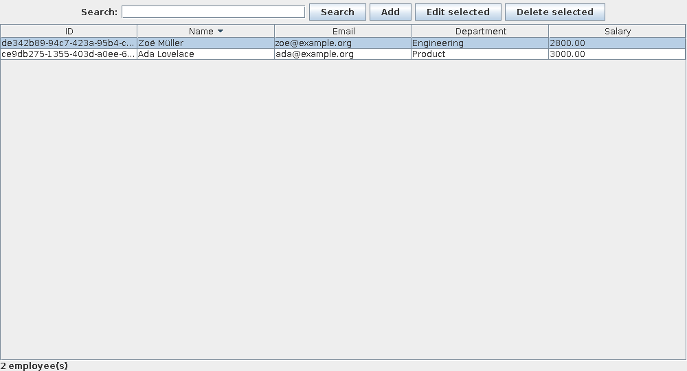

# Employee Manager — Java, Swing & JDBC

A desktop portfolio application for employee record management: create, search, edit and delete records through a Swing interface, with JDBC persistence and automated validation/database tests.

Built from an earlier university-style Java CRUD project. The refactor focuses on maintainability, reproducible setup and defensible software quality rather than enterprise HR functionality.



## Quick start

Requirements: **JDK 17+**, **Maven 3.8+**, and a desktop environment (Windows, macOS or Linux).

```sh
git clone https://github.com/Amaan325/Projects.git
cd Projects
mvn clean verify
java -jar target/employee-manager-1.0.0.jar
```

The default database is embedded **H2**, created automatically at `data/employees.mv.db` relative to your working directory. No database server or credentials are required for the local demo. The table starts empty; use fictional data. Run the app from the same directory to reopen the same database. Close the app before starting another instance against the same file.

### Walk through the app

1. Click **Add** and enter a name, email, department and salary (for example `2500.00`).
2. Search by part of a name, email or department; clear the search to list all records.
3. Select a row, click **Edit selected**, change the department and save.
4. Restart the application and confirm the record persisted.
5. Select the row and choose **Delete selected**. Confirm the deletion.

Search is case-insensitive. Percent and underscore are treated as literal characters, not SQL wildcards. Salary accepts a decimal point and up to two decimal places; no currency conversion or payroll calculation is implemented.

## Design

```text
EmployeeApp (Swing UI / background worker)
    → Employee (validated immutable record)
    → EmployeeRepository (prepared JDBC statements)
    → H2 file database, or optional MySQL server
```

- **EmployeeApp:** forms, sortable read-only table, selection and deletion confirmation. Database work runs in `SwingWorker` so the event dispatch thread remains responsive. Mutating controls are disabled during work.
- **Employee:** validates and normalizes input, permits international names, checks basic email syntax and salary bounds. UUID identifiers are created by the application.
- **EmployeeRepository:** explicit column lists and prepared statements for CRUD and search. Try-with-resources closes connections, statements and result sets on both success and failure.
- The schema is created on startup. Parameter values never become SQL syntax. Credentials come from environment variables rather than source code.

The earlier separate add/view/update/delete screens are replaced by one consistent UI. The duplicate `Conn` definitions and original default-package files are removed. This is a new schema and **does not migrate an existing legacy database**.

## Optional MySQL configuration

The MySQL JDBC driver is included in the packaged application. Create a dedicated database and a dedicated user with CREATE, SELECT, INSERT, UPDATE and DELETE privileges for that database. The app creates its table automatically. Do not use a privileged root account.

PowerShell (replace the placeholders locally):

```powershell
$env:EMPLOYEE_DB_URL = 'jdbc:mysql://localhost:3306/employee_manager'
$env:EMPLOYEE_DB_USER = 'employee_app'
$env:EMPLOYEE_DB_PASSWORD = '<your-local-password>'
java -jar target/employee-manager-1.0.0.jar
```

macOS/Linux:

```sh
export EMPLOYEE_DB_URL='jdbc:mysql://localhost:3306/employee_manager'
export EMPLOYEE_DB_USER='employee_app'
export EMPLOYEE_DB_PASSWORD='<your-local-password>'
java -jar target/employee-manager-1.0.0.jar
```

For a remote database, configure TLS and certificate validation for your deployment. `.env` files are ignored by Git but **are not automatically loaded**. H2 is the tested default; MySQL compatibility requires a separate integration check against your server.

## Tests and CI

```sh
mvn clean verify
```

JUnit tests exercise CRUD, unknown IDs, duplicate IDs, case-insensitive search, literal wildcard handling, SQL-like input, validation boundaries, repeatable initialization and file persistence across repository instances. Database tests use actual H2 connections rather than mocking JDBC. GitHub Actions builds and tests with Java 17 on pushes and pull requests.

The 12 JUnit tests passed locally. A separate Swing smoke test also passed for launch, add, edit, sorted row selection, and cancelled/confirmed deletion on a virtual display. MySQL integration remains untested.

Optional UI smoke test (use a fresh disposable database each time; close other app instances):

```sh
javac -cp target/employee-manager-1.0.0.jar -d target/ui tools/UiSmoke.java
# macOS/Linux (a graphical session is required):
EMPLOYEE_DB_URL=jdbc:h2:./target/ui-check java -cp target/ui:target/employee-manager-1.0.0.jar UiSmoke
```

On Windows, set `EMPLOYEE_DB_URL` in PowerShell and replace the classpath separator `:` with `;`. Linux CI can use `xvfb-run -a` before `java`. Tests do not require a graphical display unless you run this optional harness. See [the review notes](docs/CODE_REVIEW.md) for findings, verification and remaining limitations.

## Troubleshooting

- **`mvn` is not recognized:** install Maven and add its `bin` directory to PATH. Check `mvn -version` and that `JAVA_HOME` points to a JDK.
- **`UnsupportedClassVersionError`:** use Java 17 or later.
- **`HeadlessException`:** run the UI on a machine with a graphical desktop. Tests can run headlessly.
- **Database is locked:** close the other application instance using the same H2 file.
- **Database error dialog:** inspect the console log, JDBC URL, database permissions and environment variables. Do not share logs containing personal data or local connection details.

## Scope and limitations

This is a single-user learning/portfolio project, not production HR or ERP software. It has no authentication, authorization, audit trail, encryption-at-rest configuration, pagination, schema migration tooling or backup workflow. Updates use last-write-wins behavior; concurrent editing needs version checks before multi-user deployment. Large datasets need pagination and indexed search. The email check is syntax validation, not mailbox verification. No real employee information belongs in the demo.

## CV description

**Employee Manager | Java, Swing, JDBC, SQL** — Refactored a desktop CRUD project into a layered application with prepared statements, immutable input validation, asynchronous database operations, embedded H2 persistence, an optional MySQL configuration, Maven packaging and automated repository/validation tests.
